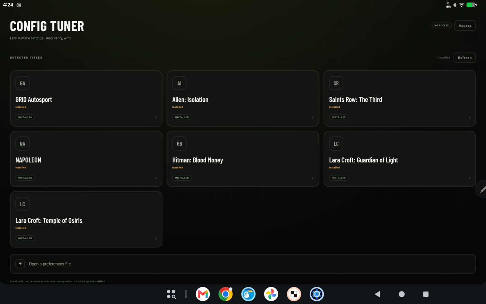
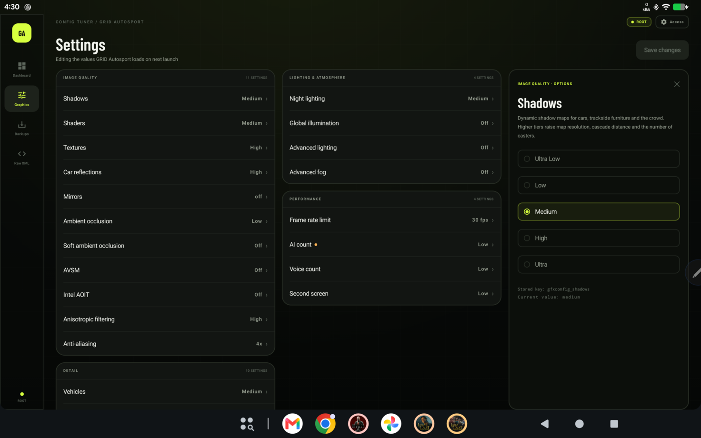
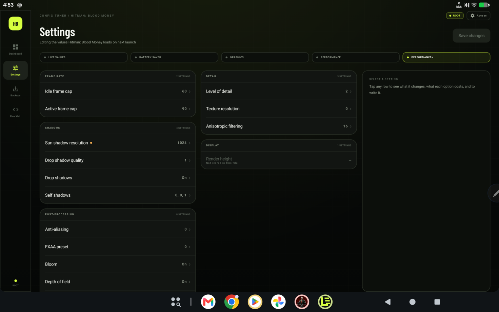
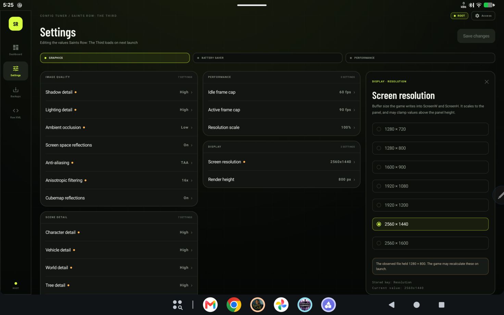

# Config Tuner

[](https://github.com/andrewr8712/legend-tuner/actions/workflows/android.yml)
[](https://github.com/andrewr8712/legend-tuner/releases/latest)
[](LICENSE)

An unofficial, tablet-first Android app for editing the graphics settings of **Feral Interactive**'s
Android ports — with readable, guided controls instead of hand-editing XML.

Formerly Legend Tuner, which edited GRID Legends only. Version 1.2 keeps the same package
(`dev.legendtuner.app`) so existing installs update in place, and adds seven more titles.



## Why

Every Feral Android port writes a plaintext XML registry to:

```text
Android/data/<package>/files/feral_app_support/preferences
```

The schema differs per game, but the shape does not: `registry > key > value` entries with string,
integer, double and array types. The games do not expose every setting in their own menus, and
Android 11+ blocks normal apps from other apps' `Android/data` folders. Config Tuner gives each title
a guided editor over that file, with backups and verified writes, plus a raw XML editor for the rest.

## Supported titles

| Title | Package | Guided controls | Variants |
|---|---|---:|---|
| GRID Legends | `com.feralinteractive.gridlegends_android` | 28 | Battery Saver · Graphics · Performance |
| GRID Autosport | `com.feralinteractive.gridas` | 29 | Current · Performance cache · Power saver cache |
| Alien: Isolation | `com.feralinteractive.alienisolation_android` | 12 | flat |
| Saints Row: The Third | `com.feralinteractive.saintsrow3_android` | 19 | Graphics · Battery saver · Performance |
| NAPOLEON: Total War | `com.feralinteractive.napoleon_android` | 16 | flat (quality index) |
| Hitman: Blood Money | `com.feralinteractive.hitmanbloodmoney_android` | 18 | Live · Battery saver · Graphics · Performance · Performance+ |
| Lara Croft: Guardian of Light | `com.feralinteractive.laracroftgol_android` | 10 | Graphics · Battery saver · Performance · Performance+ |
| Lara Croft: Temple of Osiris | `com.feralinteractive.laracrofttoo_android` | 11 | Graphics · Battery saver · Performance |

Titles are detected by package. A card is only actionable when the game is installed, or when you
open a saved `preferences` file for it. Any other supported title is listed under **Also supported**
and can be opened from a file pulled from a backup or another device.

## Features

- **Game picker on launch** — one active document at a time, with installed titles first.
- **Guided editors for all eight titles** — grouped cards, plain-language labels, a description for
  every control, option lists with the stored key shown for provenance.
- **Preset variants as tabs** — per-preset blocks (Saints Row, Lara Croft), prefixed families
  (GRID Autosport) and suffixed families (Hitman) are first-class, not raw keys.
- **Common-value dropdowns** — render height (480–2160 px) and frame caps (24–144 fps) are lists of
  common values rather than free steppers.
- **Screen resolution and resolution scale** — Saints Row exposes `ScreenW`/`ScreenH` as a paired
  resolution list (1280 × 720 … 2560 × 1600) and the render scale as 50–100 %.
- **Triple-aware Hitman controls** — uniform triples are editable and written back as a triple;
  ladders such as `1024, 1536, 2048` stay read-only, because flattening them would corrupt the preset.
- **Inverted keys handled correctly** — Hitman's `DisableBloom`/`DisableDepthOfField`/
  `DisableFinishFilter` are shown as Bloom/DOF/Finish filter, On meaning enabled.
- **Raw XML fallback** — full registry editing with validation and unknown-key preservation.
- **Automatic backups** — the previous file is stored before every save and restore; 12 snapshots kept.
- **Safe writes** — validate, back up, write, read back, parse, restore on failure.
- **Manual import keeps the title** — open a GRID Legends file from anywhere and get its guided
  editor, not a generic raw view.
- **No network permission, no analytics, no telemetry, no game assets.**

## Screenshots

| Guided editor | Preset families | Resolution controls |
|---|---|---|
|  |  |  |

Captured on a Lenovo Yoga Tab Plus TB520FU. The picker shows installed titles first and any supported
game that is not installed under **Also supported**.

## Install

**[Download the latest APK](https://github.com/andrewr8712/legend-tuner/releases/latest)** and open it
on the tablet, or:

```bash
adb install -r app-debug.apk
```

- Package: `dev.legendtuner.app` (debug builds install as `dev.legendtuner.app.debug`)
- Minimum Android: 8.0 (API 26) · Target: Android 15 (API 35)
- Version 1.2.0 (versionCode 3)
- Signed debug build

## First run

1. Launch Config Tuner. Installed Feral titles appear as cards.
2. Pick a title. If Android blocks direct access, choose a route:
   - **Root** — read/write through `su`; works on the TB520FU with KernelSU.
   - **Shizuku** — a shell-UID service for non-root devices; restart after reboot.
   - **Direct** — only usable on older/permissive Android versions.
   - **Manual file** — pick a copy with the system picker; saving writes back to that copy.

The expected path is shown on the setup screen for the selected title, for example:

```text
/Android/data/com.feralinteractive.gridas/files/feral_app_support/preferences
```

Android's system picker cannot browse `Android/data` itself. Manual mode is the fallback for devices
without Root or Shizuku, and for titles that are not installed.

## Use

1. Fully close the game. Feral titles rewrite `preferences` when they exit.
2. Open **Settings** (or **Graphics** for GRID Legends) and choose a preset tab.
3. Tap a row to read its description and pick a value.
4. Press **Save changes**. A backup is written first, then the file is written and verified.
5. Launch the game.

`Ctrl+S` saves and `Esc` closes the inspector with a keyboard attached.

### What is not editable, and why

- A control whose key is absent from the file is shown as **Not stored in this file** and cannot be
  written — Config Tuner never creates registry values.
- Hitman's per-preset values are comma triples. Uniform triples are editable; ladders are read-only.
- Amber dots mark rows where the option list or tier names still need one in-game confirmation.
- Menu entries the game shows but does not store on Android (Lara Croft's volumetric/water effects,
  Alien's field of view) are deliberately absent.

## Safety

- Close the game before saving.
- Every write creates a backup in app-private storage first.
- Writes are verified by reading the file back and parsing it; the original is restored on failure.
- No `INTERNET` permission and no network requests.
- Editing game configuration is at your own risk. This is an unofficial fan tool.

## Build

Requirements: JDK 17 or newer (JDK 21 is used locally), Android SDK platform 35, build-tools 35.0.0.

```bash
git clone https://github.com/andrewr8712/legend-tuner.git
cd legend-tuner

export JAVA_HOME=/path/to/jdk
export ANDROID_HOME=/path/to/android-sdk

./gradlew :app:testDebugUnitTest :app:assembleDebug
```

The APK is generated at `app/build/outputs/apk/debug/app-debug.apk`.

A clean checkout uses Gradle's machine-local debug signing key. Maintainers can supply a local
`keystore.properties` (ignored by git) to reproduce the release signing identity; see
[keystore/README.md](keystore/README.md).

## Tests

```bash
./gradlew :app:testDebugUnitTest
```

18 tests cover registry parsing and round-trip preservation, preset edits, live-value mirroring,
unknown keys and types, malformed XML, icon vectors, the title table, and catalogue conformance:
every guided control must have a label, a description of at least 40 characters, a known group, and
unique keys with at least two options for selectable controls.

## Project layout

```text
app/src/main/java/dev/legendtuner/app/
  access/        root shell, Shizuku service, SAF, per-title path discovery
  data/          registry parser, title table, catalogues, presets, backups
  ui/            picker, guided editor, dashboard, raw XML, backups
app/src/main/aidl/  Shizuku IFileService
docs/catalogues/    per-title control inventories and provenance
docs/superpowers/specs/  multi-title design spec
testdata/           eight sanitised real preferences samples
docs/screenshots/   real device captures used in this README
prototype/          tablet design prototype and screenshots
DESIGN.md           schema notes and design rationale
docs/CHANGELOG-1.2.0.md  what changed in this release, including verification
```

## Compatibility

- Designed for the Lenovo Yoga Tab Plus TB520FU (12.7″, 2944 × 1840).
- Verified on Android 17 with KernelSU root; Shizuku and manual modes remain supported.
- `minSdk 26` / `targetSdk 35`.
- Direct filesystem access is only usable on older or permissive Android versions.

## Disclaimer

This project is unofficial and is not affiliated with or endorsed by Feral Interactive, Sega,
Codemasters, Electronic Arts, Eidos, IO Interactive, Crystal Dynamics, The Creative Assembly, Deep
Silver, Koch Media, THQ Nordic or the franchises named above. All game titles and related marks are
the property of their respective owners. No game code, artwork, audio or save data is included; the
sanitised preferences samples in `testdata/` exist only to test the parser. See [NOTICE](NOTICE).

## License

Code is released under the [MIT License](LICENSE). See [NOTICE](NOTICE) for bundled font licences and
trademark attribution.
