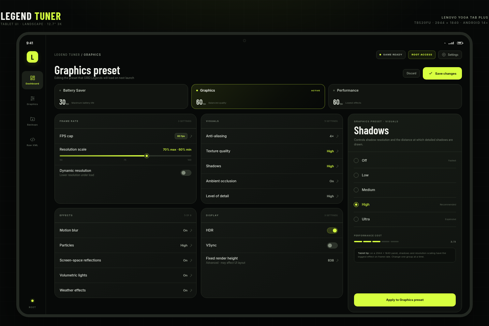

# Legend Tuner

[](https://github.com/andrewr8712/legend-tuner/actions/workflows/android.yml)
[](https://github.com/andrewr8712/legend-tuner/releases/latest)
[](LICENSE)


******Please note - This has been entirely made using DeepSeek V4.1-Flash-1017, I AM NOT A DEVELOPER. 
This was the initial Prompt - 

"There is an android game i like to play called Grid:Legends.
It has a plaintext configuration file that can be manually edited to adjust various graphical and performance options.

Instead of doing this in a text editor, I would like a native android app with a gui for easy adjustments.
Can you help develop this?"

The only other input I had was the following after trying the end result - 

"Can the fixed render height slider be changed - it's too difficult to set an exact value.
replace it with a drop down of values that correspond to common screen resolution heights."

And finally, one last prompt to upload to GitHub - 

"I would like to upload this project to github. Can you assist me in getting this done?"


An unofficial, tablet-first Android app for editing the **GRID™ Legends** graphics configuration file.

Built for the Lenovo Yoga Tab Plus **TB520FU** (12.7″, 2944 × 1840) and tested on Android 17 with Shizuku.



## Why

GRID Legends stores its graphics settings in a plaintext XML registry inside `Android/data`. Editing it by hand works, but it is easy to make a mistake — and Android 11+ blocks normal apps from that directory.

Legend Tuner gives you a proper tablet UI, readable controls, automatic backups, and three ways to reach the file:

- **Root** — direct read/write through `su`.
- **Shizuku** — a bound service running as the shell UID, for non-root devices.
- **Manual file** — pick a copy with the system file picker and write back to it.

## Features

- **Tablet-first UI** — navigation rail, two-column dashboard, three preset cards, two-column settings grid, and a docked inspector.
- **Adaptive layout** — portrait, split-screen, and compact widths fall back to a single column and a side/bottom inspector.
- **Three presets** — Battery Saver, Graphics, and Performance, matching the game's XML blocks.
- **Frame rate up to 144 fps** — plus resolution scaling, dynamic resolution, textures, shadows, reflections, effects, HDR, and VSync.
- **Fixed render height dropdown** — common 480p–2160p values, including the game default 838 and the TB520FU native 1840. Non-standard current values are preserved; use Raw XML for a new custom value.
- **Automatic backups** — the previous file is stored before every save and restore; 12 snapshots are retained.
- **Raw XML editor** — full registry editing with validation and unknown-key preservation.
- **Safe writes** — validate, back up, write, read back, parse, and restore automatically if verification fails.
- **Optional force-stop** — close GRID Legends from the editor when Root or Shizuku is active.
- **No network permission, no analytics, no telemetry, no game assets.**

## Install

**[Download the latest APK](https://github.com/andrewr8712/legend-tuner/releases/latest)** and open it on the tablet.

Or, with ADB:

```bash
adb install -r LegendTuner-debug.apk
```

- Package: `dev.legendtuner.app.debug`
- Minimum Android: 8.0 (API 26)
- Target: Android 15 (API 35)
- Signed debug build

If Android blocks the install, enable **Install unknown apps** for your browser or file manager.

## First run

The game file is at:

```text
/Android/data/com.feralinteractive.gridlegends_android/files/feral_app_support/preferences
```

Android 11+ blocks normal apps from other apps' `Android/data` folders. Choose one of the routes below.

### Root

Tap **Root** and authorize the `su` prompt.

### Shizuku (no root)

1. Install [Shizuku](https://shizuku.rikka.app/download/).
2. Start Shizuku with wireless debugging.
3. In Legend Tuner, choose **Shizuku** and grant access.

Shizuku must be started again after a reboot.

### Manual file

Tap **Manual file** and choose a copy of `preferences` that the system picker can see — for example one in Downloads. Saving writes back to that copy. If you copied the file out of `Android/data` with a file manager, copy the edited file back the same way.

> Android's system picker cannot browse `Android/data` itself. Manual mode is the fallback for devices without Root or Shizuku.

## Use

1. **Fully close GRID Legends.** The game rewrites `preferences` when it exits.
2. Open **Graphics** and choose a preset.
3. Tap any row to edit it in the inspector.
4. Press **Save changes**. Saving makes the selected preset active and mirrors its values into the live `GraphicsSettings`.
5. Launch GRID Legends.

For fixed render height: **Graphics → Display → Fixed render height**, choose a height, press **Apply**, then **Save changes**.

`Ctrl+S` saves and `Esc` closes the inspector when a keyboard is connected.

### Fixed render height choices

`480, 540, 600, 720, 768, 800, 838, 900, 960, 1080, 1200, 1440, 1600, 1800, 1840, 2160`

The menu labels the game default (838), Full HD (1080), QHD (1440), TB520FU native (1840), and 4K (2160).

## Safety

- Close the game before saving.
- Every write creates a backup in app-private storage first.
- Writes are verified by reading the file back and parsing it; the original is restored if verification fails.
- The app has no `INTERNET` permission and makes no network requests.
- Editing game configuration is at your own risk. This is an unofficial fan tool.

## Build

Requirements: JDK 17, Android SDK platform 35, build-tools 35.0.0.

```bash
git clone https://github.com/andrewr8712/legend-tuner.git
cd legend-tuner

export JAVA_HOME=/path/to/jdk17
export ANDROID_HOME=/path/to/android-sdk

./gradlew :app:testDebugUnitTest :app:assembleDebug
```

The APK is generated at:

```text
app/build/outputs/apk/debug/app-debug.apk
```

A clean public checkout uses Gradle's normal machine-local debug signing key. Maintainers can supply a local `keystore.properties` (ignored by git) to reproduce the release APK's signing identity; see [keystore/README.md](keystore/README.md).

## Tests

```bash
./gradlew :app:testDebugUnitTest
```

The suite covers parsing the real registry, full round-trip preservation, preset first-token edits, live-value mirroring, unknown-key rejection, malformed XML, icon vectors, catalog ranges, and the fixed-height dropdown.

## Project layout

```text
app/src/main/java/dev/legendtuner/app/
  access/        Root, Shizuku UserService, SAF, storage path discovery
  data/          XML registry parser, presets, catalog, backups
  ui/            adaptive Compose UI
  MainActivity.kt
app/src/main/aidl/  Shizuku IFileService
testdata/          sanitized real preferences sample
prototype/         tablet design prototype and screenshots
DESIGN.md          schema notes and design rationale
```

## Compatibility

- Designed for the Lenovo Yoga Tab Plus TB520FU at 2944 × 1840.
- Verified on Android 17 with Shizuku.
- `minSdk 26` / `targetSdk 35`.
- Direct filesystem access is only usable on older/permissive Android versions; use Root, Shizuku, or Manual on modern Android.

## Disclaimer

This project is unofficial and is not affiliated with or endorsed by Feral Interactive, Electronic Arts, Codemasters, or the GRID franchise. GRID™ Legends and related marks are the property of their respective owners. No game code, artwork, or audio assets are included. A sanitized preferences sample is used only for parser tests.

The XML structure is based on a publicly shared, sanitized preferences sample; see [testdata/README.md](testdata/README.md).

## License

Code is released under the [MIT License](LICENSE). See [NOTICE](NOTICE) for the Barlow Condensed font license and trademark attribution.
