# Legend Tuner — Project Workflow Report

> **Project:** [Legend Tuner](https://github.com/andrewr8712/legend-tuner)  
> **Release:** [v1.1.0](https://github.com/andrewr8712/legend-tuner/releases/tag/v1.1.0)  
> **Device:** Lenovo Yoga Tab Plus TB520FU · Android 17 · Shizuku  
> **Companion report:** Token, Cost & Performance Report (`REPORT.md`, upload alongside)  
> **Prepared:** 2026-10-30

---

## 1. Purpose

This report documents **how the project was built**: the discovery work, design decisions, implementation sequence, validation gates, release process, and the human/agent collaboration loop.

It is intended to be useful to:

- someone maintaining or extending Legend Tuner;
- someone building a similar Android config editor;
- anyone curious about the practical workflow behind the app.

---

## 2. Workflow at a glance

```mermaid
flowchart LR
    A["Requirements & device context"] --> B["Config format discovery"]
    B --> C[UI prototype]
    C --> D[Design approval]
    D --> E[Android scaffold]
    E --> F[Parser + safety model]
    F --> G[Root / Shizuku / manual access]
    G --> H[Compose tablet UI]
    H --> I[Unit tests + APK]
    I --> J[GitHub repo + CI + release]
    J --> K[On-device feedback]
    K --> L[Dropdown iteration]
    L --> M[Reporting]
```



| Phase | Main output | Gate before moving on |
|---|---|---|
| 1. Requirements | Device, Android version, access constraints | User confirmed tablet + Shizuku |
| 2. Discovery | Real XML schema and file path | Sample parsed successfully |
| 3. Design | Phone + tablet prototypes | User approved tablet direction |
| 4. Toolchain | JDK 17, Android SDK 35, Gradle 8.9 | Project compiled |
| 5. Implementation | Parser, access layer, Compose UI | Unit tests passed |
| 6. Release | Signed APK, GitHub repo, CI, release | CI green + user installed |
| 7. Iteration | Fixed-height dropdown, v1.1.0 | Rebuilt and re-released |
| 8. Reporting | Token/cost report + this workflow report | Figures reconciled to session ledger |

---

## 3. Phase 1 — Requirements and constraints

The first request was broad: replace manual text editing of the game's config with a native Android GUI.

The important constraints emerged through short, targeted questions:

- **Device:** Lenovo Yoga Tab Plus **TB520FU**, not a phone.
- **Display:** 12.7″, 2944 × 1840, 16:10.
- **Android:** 14+ initially; later confirmed running **Android 17**.
- **Access:** Shizuku available, with Root and manual modes also desired.
- **Delivery:** prototype review first, then a signed APK.
- **UI:** tablet-friendly, not a stretched phone layout.

This changed the project from "a settings form" into:

1. a **scoped-storage access tool**;
2. a **lossless XML editor**;
3. a **tablet-first Compose UI**;
4. a **safe write pipeline** with backups and verification.

---

## 4. Phase 2 — Discovering the real config format

The first technical unknown was the file itself.

### Findings

- Path: `/Android/data/com.feralinteractive.gridlegends_android/files/feral_app_support/preferences`
- Format: an XML "registry" with `key` and `value` elements.
- Graphics settings live under `HKEY_CURRENT_USER/Software/Feral Interactive/GRIDLegends/GraphicsSettings`.
- Presets are stored in `BatterySaver`, `Graphics`, and `Performance` blocks.
- Most values are comma-separated triples such as `"1, 1, 1"`.
- The live `GraphicsSettings` integer values matched the **first token** of the active preset in the inspected v1.1.5 sample.
- The active preset is recorded in `GraphicsSettings/DevicePreset` (0/1/2).

A sanitized sample was added under [`testdata/preferences-sample.xml`](testdata/preferences-sample.xml) for parser tests.

### Design consequence

The app does **not** use a fixed schema that rewrites the whole file. It:

- parses the XML tree;
- looks up exact paths;
- mutates only the requested value;
- preserves unknown keys, types, ordering, and trailing triple tokens;
- validates before and after writing.

This decision is the main reason the app can survive game updates better than a naive text-replacement tool.

---

## 5. Phase 3 — Prototype before implementation

Because the target was a 12.7-inch tablet, a phone UI would have been the wrong starting point. Two visual prototypes were produced:

1. a phone-shaped concept for the compact fallback;
2. a tablet concept with:
   - navigation rail;
   - two-column dashboard;
   - three preset cards;
   - two-column settings grid;
   - docked 350 dp inspector.

The tablet direction was approved before the Android project was built. This avoided implementing a layout that would later need a structural rewrite.

The prototype files remain in [`prototype/`](prototype/) and are used in the README.

---

## 6. Phase 4 — Toolchain and project scaffold

The build environment initially had no Gradle, no Android SDK, and only JDK 27.

Work performed:

- installed **JDK 17** (Temurin);
- downloaded **Android command-line tools**;
- installed **platform 35** and **build-tools 35.0.0**;
- generated a **Gradle 8.9** wrapper;
- created a single-activity Kotlin/Compose project;
- pinned compile/target SDK 35 and min SDK 26.

Two environment issues were resolved along the way:

| Issue | Resolution |
|---|---|
| Gradle native library failed because the home cache was read-only | Set `GRADLE_USER_HOME` inside the workspace |
| SDK manager could not fetch manifests because `~/.android` was read-only | Set `ANDROID_USER_HOME` to a writable workspace directory |
| Build-tools 34 auto-install stalled | Pinned `buildToolsVersion = "35.0.0"` |

The project was compiled early, before the full UI existed, to catch build-system problems separately from app code.

---

## 7. Phase 5 — Implementation workflow

Implementation was split into four layers.

### 7.1 Data layer

- `ConfigDocument` — secure DOM parser, path lookup, value mutation, serialization, validation.
- `Preset` — Battery Saver / Graphics / Performance mapping.
- `SettingsCatalog` — friendly labels, ranges, groups, descriptions, risk flags.
- `BackupStore` — timestamped snapshots, rotation, restore.

### 7.2 Access layer

- `GamePaths` — scans internal storage and every mounted volume for the game directory.
- `RootAccess` — `su` shell, with quoted paths and timeout-safe command execution.
- `ShizukuAccess` — official Shizuku `UserService` running as the shell UID.
- `SafAccess` — system picker import/export for devices without Root or Shizuku.
- `DirectFileAccess` — legacy path for older/permissive Android versions.

The key design decision: **the app never calls a shell with interpolated user text**. Paths are fixed or derived from system storage volumes.

### 7.3 UI layer

- Adaptive width breakpoints rather than a fixed orientation.
- Navigation rail on tablet; compact bottom bar on narrow screens.
- Two-column dashboard and settings grid.
- Docked inspector at ≥1000 dp; side/bottom sheet below that.
- Custom local icon vectors instead of the large `material-icons-extended` pack.
- Bundled Barlow Condensed for headings; system sans for body text.

### 7.4 Safety layer

Every save follows the same sequence:

```text
serialize draft
  → create backup of original bytes
  → write to the game file
  → read the file back
  → parse and validate it
  → verify active preset
  → on failure, restore the original
```

No silent writes. No "save" without a backup.

---

## 8. Phase 6 — Validation

### Automated

- **10/10 unit tests** pass.
- Coverage includes:
  - real registry parsing;
  - full value/path/type round-trip;
  - first-token preset edits;
  - live-value mirroring;
  - unknown-key rejection;
  - malformed XML;
  - icon vector parsing;
  - catalog ranges;
  - fixed-height dropdown values.

### Build

- `:app:compileDebugKotlin` passes.
- `:app:assembleDebug` produces a signed APK.
- APK Signature Scheme v2 verified.
- No `INTERNET` permission.
- Final APK: 9.94 MB, version 1.1.0 (code 2).

### Runtime

There was **no Android device attached to the build environment**, so runtime verification was user-driven:

- APK installed on the TB520FU;
- access confirmed with Shizuku;
- app reported working on Android 17.

This is why the workflow relied on a reviewable prototype and conservative safety checks rather than claiming untested device behavior.

---

## 9. Phase 7 — GitHub, CI, and release

The source was prepared as a public repository:

- **MIT license**;
- README, screenshots, install and access instructions;
- `CHANGELOG.md`, `CONTRIBUTING.md`, `SECURITY.md`, issue template;
- no signing key, APK, or build output committed;
- release APK distributed through **GitHub Releases**.

### CI pipeline

```text
checkout
  → JDK 17
  → install Android SDK 35 + build-tools 35
  → Gradle cache
  → unit tests + assembleDebug
  → upload APK artifact
```

### CI issues fixed

| Issue | Fix |
|---|---|
| `android-actions/setup-android@v3` tried to install the removed `tools` package | Removed the action; installed SDK packages directly with `sdkmanager` |
| `java.util.Properties` unresolved in `build.gradle.kts` | Added an explicit `import java.util.Properties` |
| Signing config assumed a local key | Made local signing optional; clean checkouts use Gradle's standard debug key |

Final CI is green at the release commit.

### Release

- Tag: `v1.1.0`
- APK + SHA-256 attached
- Tag moved to the final CI-green commit
- Release marked latest

---

## 10. Phase 8 — Iteration

After the first install, the user asked for a usability change:

> The fixed render height slider is too hard to set exactly. Replace it with a dropdown of common heights.

Workflow:

1. changed `FixedScreenHeight` from a numeric slider to a `DROPDOWN` setting type;
2. added common values from 480 to 2160, including:
   - **838** — game default;
   - **1080** — Full HD;
   - **1440** — QHD;
   - **1840** — TB520FU native;
   - **2160** — 4K;
3. preserved a non-standard current value as a custom entry;
4. added a regression test;
5. rebuilt and verified version 1.1.0;
6. published a new release asset.

This is the intended long-term loop: **install → observe friction → make a small change → test → release**.

---

## 11. Collaboration model

### 11.1 Division of roles

The project worked as a **product-owner / implementer loop**:

| Role | Responsibility |
|---|---|
| **User** | Defined the goal, device, access environment, delivery preference, and acceptance feedback; installed and tested the APK; approved release decisions |
| **Agent** | Researched the config format, proposed the UI, selected the technical stack, implemented the app, built the toolchain, tested it, published the repository/release, and wrote the reports |

This was not a case of the user handing over a complete specification and the agent simply typing it out. The user supplied a small number of **high-leverage constraints**, then relied on the agent for most of the discovery and implementation. That was a reasonable division for this engagement, but it means several assumptions were agent-made rather than user-confirmed.

### 11.2 What the user actually supplied

| Information | Specificity | Effect on the project |
|---|---|---|
| “Native Android app with a GUI for the GRID Legends plaintext config” | **High-level, clear** | Established the product goal and platform |
| “I have the game installed on a tablet… Lenovo Yoga TB520FU” | **Specific and decisive** | Stopped the phone-first UI direction; triggered the tablet redesign |
| Android 14+, later confirmed Android 17 | **Specific** | Set min/target compatibility expectations and testing context |
| Shizuku available; chose “all access modes” | **Specific enough** | Led to Root + Shizuku + manual SAF architecture |
| “Plan/prototype first” | **Specific** | Forced a design checkpoint before full implementation |
| “go” | **Clear approval** | Authorized the full build |
| Installed the APK and reported it worked | **Qualitative smoke test** | Confirmed the app launches and basic operation on the target device |
| “Make it tablet friendly” | **Directional, not a spec** | The agent chose the rail, two-column grid, and docked inspector |
| “Replace the fixed-height slider with a dropdown” | **Specific, actionable** | Produced a focused v1.1.0 change |
| Public repo, MIT, GitHub Releases, device login | **Specific release decisions** | Drove repository and distribution setup |
| Current pricing URL | **Specific** | Allowed the cost report to be recalculated against official rates |

### 11.3 What the user did **not** supply

| Missing information | How it was handled | Residual risk |
|---|---|---|
| The actual `preferences` file | Found a public sample, inspected the real XML, sanitized it for tests | Game-version differences could still exist |
| Config path, key names, preset mapping | Derived from the sample and a public guide | Active preset mapping is verified for the sample, not every game build |
| Meaning of the comma-separated triples | Observed that live values matched the first token; preserved the rest | The trailing tokens are preserved but not semantically proven |
| Android scoped-storage rules | Researched Android 11+ `Android/data` restrictions | Shizuku/manual fallback complexity was necessary |
| UI specification | Designed a tablet UI and asked for approval | “Tablet friendly” left many concrete choices to the agent |
| Stack, architecture, dependencies | Chose Kotlin, Compose, DOM parsing, Shizuku UserService, SAF | Standard choices, but not user-reviewed |
| Build, signing, CI, release process | Created the toolchain, APK signing, GitHub Actions, release | Maintainer must keep the signing key safe |
| Formal acceptance criteria | Relied on “seems to work well” plus unit tests | The actual save → launch-game → verify path was not formally documented |
| Measured FPS / thermal baseline | Gave configuration advice after the fact | 1080p60 remains a hypothesis until tested |

### 11.4 Was the information specific enough?

**For the product goal: yes.** The user named the game, the platform, the form factor, the access environment, and the delivery preference. Those were the decisions that mattered before architecture and UI work. In particular:

- the **TB520FU tablet detail** arrived before the UI was built, preventing a phone-first implementation;
- the **Shizuku/Android 17** context made the privileged-access design realistic;
- the **prototype-first** choice created a natural review gate;
- the **“go”** approval was unambiguous.

**For the implementation: no, and that was intentional.** The user did not specify the XML schema, UI breakpoints, access implementation, dependency choices, test strategy, signing, CI, or release mechanics. The agent handled that “heavy lifting.” That is why the project could move from a one-paragraph request to a published APK in one session.

**For acceptance: partially.** “Seems to work well” is a useful smoke test, but it is not the same as:

- saving a preset;
- fully closing the game;
- relaunching it;
- confirming the setting actually applied;
- confirming a backup can be restored;
- confirming 1080p60 holds for 15+ minutes without thermal throttling.

Those are the checks that would turn “it launches” into “the core workflow is proven.”

### 11.5 Did the user just give vague details and rely on the agent?

**A mix, leaning toward delegation rather than vagueness.**

- The **product constraints were specific**: device, tablet, Shizuku, Android 17, native app, prototype first.
- The **technical specification was largely absent**: schema, storage access, architecture, UI layout, testing, and release were agent-led.
- The user acted as **product owner and real-device tester**, not as a technical co-implementer. That is a legitimate way to run the project, but it puts more weight on agent assumptions.
- The most expensive ambiguity was **not** the UI. It was the absence of a real `preferences` file at the start. That forced public-source discovery and left version-specific assumptions in the parser.
- The second was **access**: “all modes” is a valid choice, but it is broader than “Shizuku only,” so more implementation and UI work went into Root/manual fallbacks.
- The third was **acceptance**: the 1080p60 target arrived late and was never measured, so the performance advice remains a starting profile rather than a validated result.

So: **the user did not give a fully specified brief, and did rely on the agent for the majority of the implementation. But the details provided were high-leverage and arrived at the right checkpoints.** The collaboration worked because ambiguous areas were exposed through prototypes and questions before they became expensive rewrites.

### 11.6 Where the handoff was strong

1. **Device constraint before UI implementation** — the tablet correction changed the design early.
2. **Prototype-first delivery** — made “tablet friendly” concrete before Compose work.
3. **Access environment disclosure** — Shizuku/Android 17 shaped the file-access layer.
4. **Fast approval** — “go” avoided a long requirements phase.
5. **Real-device installation** — the only practical runtime validation available.
6. **Focused iteration** — the dropdown request was small, clear, and testable.
7. **Release decisions** — public/MIT/Releases/device login were explicit and quick.

### 11.7 Where the handoff could be stronger

- Provide a **sanitized real config file** with the initial request.
- State **root vs Shizuku vs manual** as a hard requirement, not “all modes,” if only one is actually usable.
- Define **acceptance criteria** up front, for example:
  - “APK installs on Android 17.”
  - “Save persists after force-stopping and relaunching the game.”
  - “1080p60 holds for a 15-minute race.”
  - “Backup can restore the previous file.”
- Include one **current settings screenshot** and a measured FPS baseline.
- Decide **debug vs release signing**, license, and repository visibility before the final packaging step.
- Confirm whether “it works” includes a successful **game-side** verification, not just app navigation.

### 11.8 Collaboration timeline

| Checkpoint | User action | Agent action | Result |
|---|---|---|---|
| 1. Brief | Described the game and the GUI goal | Inspected environment, asked scoped questions | Shared understanding |
| 2. Device correction | Specified TB520FU tablet | Reworked the phone design into a tablet layout | Tablet-first UI |
| 3. Approval | “go” | Built the full Android project | Installable APK |
| 4. Runtime feedback | Installed and reported success | Moved to GitHub/release work | Public v1.1.0 |
| 5. UX iteration | Requested exact-height dropdown | Implemented, tested, versioned | v1.1.0 update |
| 6. Reporting | Asked for token/cost/workflow reports | Reconciled session ledger and pricing | GitHub-ready documents |

## 12. What went well

- Grounding the parser in a **real config sample** prevented an invented schema.
- Reviewing a **visual prototype** before coding avoided a phone-first UI rewrite.
- Separating access, parsing, UI, and safety made failures easier to isolate.
- Automatic backups and read-back verification made file writes defensible.
- Local icon vectors kept the APK/build lean.
- CI caught two portability problems that a local build alone would have missed.
- GitHub Releases kept binaries out of git history while still giving users a one-tap download.

## 13. What to improve next time

- Obtain a real `preferences` file **before** designing the parser.
- Confirm Root vs Shizuku vs manual access **before** UI work.
- Add CI on the first commit, not after the first release.
- Use an emulator or a debug bridge for at least one automated UI smoke test.
- Add screenshot tests for the tablet and portrait layouts.
- Consider a `:core` module if the parser/access layers grow.
- Add a one-tap **“TB520FU 1080p60”** profile for performance tuning.
- Keep the signing key outside the repository from day one (this was corrected before publication).

---

## 14. Reproducible workflow checklist

For a similar project:

1. **Inventory the environment** — JDK, Android SDK, Gradle, device access.
2. **Get ground truth** — a real config file, version, and path.
3. **Model the data safely** — parse, preserve unknown fields, validate.
4. **Design for the actual screen** — tablet/desktop breakpoints, not stretched phone UI.
5. **Prototype and get approval** before building the full app.
6. **Compile early**; solve toolchain issues before app complexity.
7. **Separate privileged access** from UI and parsing.
8. **Back up before every write; verify after every write.**
9. **Test on the real device** — the only proof that storage access works.
10. **Publish source with CI and releases**, never with signing keys or build output.
11. **Iterate in small versions** and keep a changelog.

---

## 15. Final status

| Area | Status |
|---|---|
| App | Working on TB520FU, Android 17, Shizuku |
| Source | Public, MIT-licensed |
| Tests | 10/10 passing |
| CI | Green |
| Release | v1.1.0, APK + checksum |
| Known limitation | No automated on-device UI test; runtime validation is manual |
| Next logical feature | One-tap tablet performance profile |

---

## Links

- [Repository](https://github.com/andrewr8712/legend-tuner)
- [Latest release](https://github.com/andrewr8712/legend-tuner/releases/latest)
- [GitHub Actions](https://github.com/andrewr8712/legend-tuner/actions)
- Token, Cost & Performance Report — `REPORT.md` (upload alongside this file)
- [Design notes](DESIGN.md)
